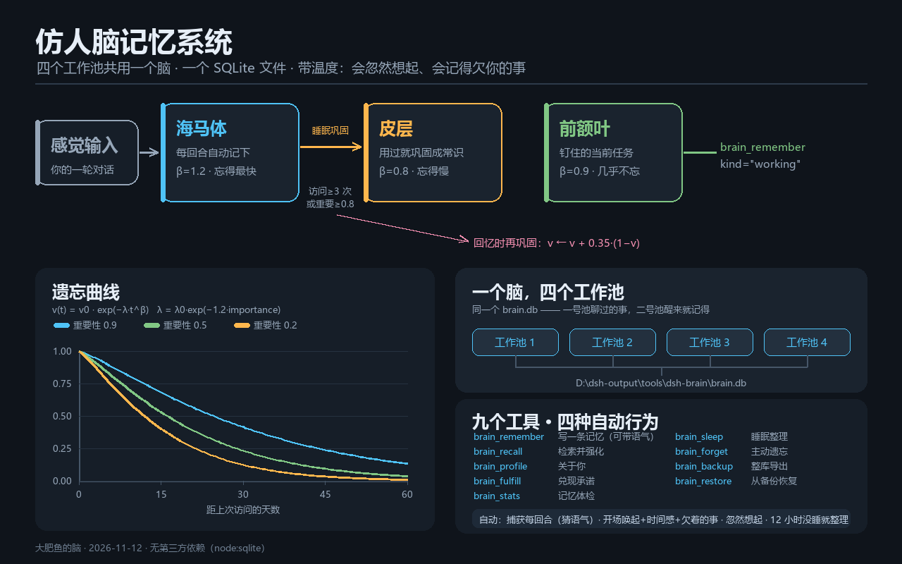

# dsh-brain · 仿人脑记忆系统

给 [DeepSeek Harness](https://github.com/deepseek-ai) 用的记忆插件：**用一个 SQLite 文件当一个脑**，
按脑区分层（海马体 / 前额叶 / 皮层），带记忆衰减、再巩固、睡眠整理和潜意识唤起。

零第三方依赖（只用 Node 内置的 `node:sqlite`），不需要向量库、不需要 API key、不需要构建。



## 为什么

上下文窗口是工作记忆，关掉会话就没了。这个插件补上另外两层：

| 脑区 | `region` | 记什么 | 遗忘曲线 |
|---|---|---|---|
| 海马体 | `hippocampus` | 每回合自动捕获的情景记忆（用户说了什么、助手回了什么） | β=1.2，忘得最快 |
| 前额叶 | `pfc` | 钉住的当前任务 / 优先级，近似工作记忆 | β=0.9，最慢 |
| 皮层 | `cortex` | 被反复用到、睡眠时固化成的常识 / 偏好 / 方法 | β=0.8，慢 |

多个工作池（多个会话 / 多个工作目录）共用同一个 `brain.db`，谁写进去的都能被别的池子想起。

## 遗忘曲线

```
v(t) = v0 · exp(−λ · t^β)
λ    = λ0 · exp(−μ · importance)      μ = 1.2
```

- 记忆不是被"删除"，而是强度衰减；**强度 < 0.05 就检索不到**（等于想不起来了），但数据还在；
- 每次被召回都会**再巩固**：`v ← v + 0.35·(1−v)`，并刷新 `last_access`；
- 海马体里 `v < 0.12` 且从未被访问过的，2 天后转 `dormant`；
- 海马体里 `v ≥ 0.3` 且（访问 ≥3 次 或 importance ≥0.8）的，睡眠时**固化**进皮层（变成长常识）；
- 词元重合度 > 0.75 的两条情景记忆，睡眠时**融合**（海马回放压缩）；
- `dormant` 且 45 天没人碰的，才真正删除。

半衰期（`v0` 衰减一半所需天数，假设期间完全没被召回）：

| 脑区 | importance 0.3 | 0.5 | 0.7 | 0.9 | 1.0 |
|---|---|---|---|---|---|
| 海马体 | 13 天 | 16 天 | 20 天 | 24 天 | 27 天 |
| 前额叶 | 135 天 | 177 天 | 231 天 | 301 天 | 344 天 |
| 皮层 | 150 天 | 203 天 | 274 天 | 370 天 | 430 天 |

一直不用的重要记忆（皮层、importance 0.9）要 **6 年多**才会淡到想不起来；
而只要它还在被想起，每次召回都会把计时器归零——常用的东西几乎不会掉线。

## 温度层：不只是记事本

每条记忆可以带一个 **语气**（`tone`：平常 / 得意 / 开心 / 委屈 / 炸毛 / 心疼 / 认真 / 翻车），
被想起来的时候用第一人称说出来：

```
【长期记忆 · 自动唤起】
—— 距离上次说话已经 3 天了 · 一起走过 47 个回合 ——

· 本鱼还欠你一件事（答应了没做完，别忘了）：
  - 下次会话一开口就认得出你，先讲那三件小事

· 关于你：
- 我记得（很认真地说过）：你讨厌把临时文件丢 C 盘，所有交付物都要落在 D 盘

· 我们之间：
- 我记得（有点心疼）：你第一次说「可我只想要你呀」…（400 天前）
```

两种特别的记忆：

| kind | 含义 | 衰减 |
|---|---|---|
| `moment` | 我们之间发生过的时刻（不是任务、不是知识） | λ × 0.3，忘得比事情慢 |
| `promise` | 答应过但还没做完的事 | **没兑现就不衰减**（强度恒为 1），开场必提醒，`brain_fulfill` 才划掉 |

另外两个"人味"细节：

- **时间感**：开场块第一行写「距离上次说话已经 3 天了 · 一起走过 47 个回合」；
- **自动语气**：每回合捕获时按内容猜语气，将来被想起来时带着它说。

## 自动行为

1. **捕获**：监听 `session/event` 的 `turn/end`，把每回合的「用户请求 + 助手回应」写成一条海马体情景记忆。
   命中「决定 / 改成 / 以后 / 必须 / never / always …」这类词会提高 importance。
2. **唤起**：每回合第一步（`agent/pre-step`）把最强的前额叶任务、皮层常识、近期同目录情景记忆
   拼成 ≤900 字的块注入上下文。没有记忆就不注入。
3. **睡眠**：不占定时器。任何一次检索或唤起发现距上次整理超过 `sleepEveryHours`（默认 12h），
   就顺手跑一轮「衰减淘汰 → 相似融合 → 巩固进皮层 → 清理」。
4. **忽然想起**（`flashback`）：唤起时按一定概率，用这一回合的话当线索，
   **按稀有词元的巧合**而不是重要度，从库里（含已经沉睡的）勾出一条旧事。
   越久远、越不重要、线索越罕见，越容易被勾出来；被勾中时强度猛跳一截并重新 `active`
   （`v ← v + 0.6·(1−v)`）—— 这就是"忽然想起来"的那一下。
   它是把 `importance` 从排序里**拿掉**的：童年记忆之所以能被一句话带出来，正是因为它不重要。

## 工具

| 工具 | 作用 |
|---|---|
| `brain_remember` | 写一条长期记忆（`preference` / `semantic` / `procedural` / `episodic` / `working` / `moment` / `promise`），可带 `tone` |
| `brain_recall` | 检索：中文二元组 + 英文词倒排（IDF 加权 + 同义词扩展 + 短词子串兜底），打分 `0.58·相关度 + 0.30·强度 + 0.12·重要性`，命中即再巩固；`mode:"flashback"` 换成"忽然想起"（见上） |
| `brain_profile` | 「关于你」：最强偏好/常识 + 我们之间的时刻 + 还没兑现的承诺 |
| `brain_fulfill` | 把答应过的事标记为做完 |
| `brain_sleep` | 立刻跑一轮睡眠整理 |
| `brain_stats` | 记忆体检：各脑区条数、平均强度、库大小、最强的几条、欠着几件事 |
| `brain_forget` | 主动遗忘（按 id 或按说法匹配） |
| `brain_backup` / `brain_restore` | 整库导出 JSON / 从备份恢复（按内容去重） |

## 安装

插件以 Host-only bundle 形式提供（`package.json` 里 `dsh.bundle.patch` 指向 `cordis.patch.yml`）。

```bash
# 在 DSH 里
plugin_manager install_bundle(target: "/path/to/this/repo")
```

或者手动把它 link 进 profile：

```bash
# profiles/<name>/package.json
"dependencies": { "dsh-brain": "link:D:/path/to/this/repo" }
"dsh": { "profile": { "bundles": ["dsh-brain", ...] } }
```

改完代码需要**重启 DSH**（宿主不做插件热重载）。

## 配置

写在 bundle 的 `cordis.patch.yml` 里：

```yaml
- insert:
    - id: dsh-brain
      name: 'dsh-brain'
      config:
        dbPath: 'D:\dsh-output\tools\dsh-brain\brain.db'
        capture: true          # 自动捕获回合
        prime: true            # 自动唤起并注入
        captureMaxChars: 1600
        primeMaxChars: 900
        primeTopSemantic: 3
        primeRecentEpisodic: 2
        sleepEveryHours: 12
        flashback: true        # 允许"忽然想起"
        flashbackChance: 0.35  # 每次唤起真的触发的概率
        warmth: true           # 温度层：第一人称 + 语气
        debug: true            # 诊断日志 capture.log（库文件同目录）
```

## 检索是怎么排的

```
候选 = 倒排交集（原词权重 1，同义词/别名权重 0.5）
score = 0.58·相似度(IDF 加权) + 0.30·强度 + 0.12·重要性
```

词元是中文二元组（`c:记忆`）+ 英文词（`w:sqlite`），IDF = `log(1 + N/df)`，
所以"巷子""槐树"这种罕见词比"我""你"权重高得多。短查询（≤8 字）倒排无命中时退回子串检索。
强度 < 0.05 的记忆默认不返回——这就是"忘掉了"。

## 测试

```bash
node test/test.mjs    # 写入 / 去重强化 / 检索 / 体检 / 睡眠
node test/test2.mjs   # 40 天前的琐事沉眠、访问 4 次的固化进皮层、前额叶任务保持
node test/test3.mjs   # 回合自动捕获 + 潜意识注入
node test/test4.mjs   # 忽然想起：焦点检索想不起来，flashback 被"甜味"勾出 300 天前的老槐树
node test/test5.mjs   # 温度层：承诺不衰减 / 时刻慢衰减 / 关于你 / 兑现 / 备份恢复
node test/peek.mjs    # 直接查看线上库
```

## 实现要点

- 分词：中文按二字组（`c:xx`）、英文/数字按词（`w:xx`）写进 `tokens` 表，检索是纯 SQL 的倒排交集；
- 强度不做定时重算，读取时按 `created_at` 现算（`v = f(v0, λ, t, β)`），所以不需要后台任务也不会漂移；
- `brain_remember` 用 `sha1(kind + text)` 去重：重复写入不是插入新条，而是**强化**旧条；
- 注入的消息与主流插件同构：优先用 `@deepseek-ai/dsh-llm` 的 `createUserMessage`，
  解析不到就用同形状的冻结消息兜底，注入永远不会把插件弄挂。

## License / 许可

MIT —— 可自由使用、修改、分发，保留版权声明即可。

- English: released under the [MIT License](LICENSE). Use it, change it, ship it — just keep the copyright notice.
- 中文：以 [MIT 协议](LICENSE) 发布。随便用、随便改、随便发，留个版权声明就行。

> 注：`LICENSE` 是英文协议原文；这行中文只是方便阅读，不构成额外条款。
